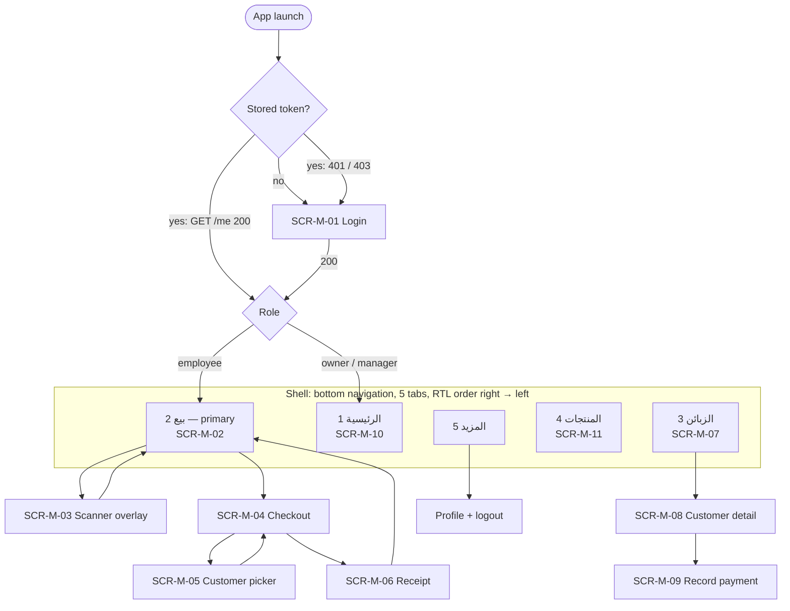

# Mobile IA, Navigation and State Matrix (US-1505)

> **PROPOSAL — for DR-1.** Not approved until [reviews/DR-1.md](reviews/DR-1.md) records "approve".
> Sources: [06 §2–§6](../sdlc/proposed/06-ui-ux-and-screen-plan.md), [14 §5.3–§5.5](../sdlc/proposed/14-sprint-1-execution-plan.md), the frozen auth contract [docs/api/auth.http](../api/auth.http) and [error-codes.md](../api/error-codes.md).

## 1. Navigation map (R1)

| Rule | Decision |
|---|---|
| Tab order | RTL: the first tab (الرئيسية) is at the right edge. POS is the centre tab and visually emphasised. |
| Role landing | Employee → **POS**. Owner / Manager → **Home**. Applied after login and after session restore. |
| Tab state | Each tab keeps its own stack. Re-tapping the active tab returns to its root. **The POS cart survives tab switches** (it is in-memory app state, not screen state). |
| Back | Android back pops the tab stack; at a tab root it goes to the landing tab; at the landing tab root it exits. Back on Checkout returns to the cart with nothing lost. |
| Session expired (401 anywhere) | A full-screen re-login interrupt over the current screen. After re-login as the **same** user, the user returns to the same screen with in-memory state (e.g. the cart) intact. A different user → state is cleared and role landing applies. |
| Account deactivated (403 `USER_INACTIVE` anywhere) | Token cleared; the "account deactivated" screen; only action: back to login. |
| Offline | A banner under the app bar on every tab: "لا يوجد اتصال — البيع يحتاج إنترنت". Buttons that need the server stay visible but show the reason when tapped. |
| More tab (R1) | Profile (name, role, store) and Logout. Returns, AI assistant and sync are added in later releases. |

## 2. Screen inventory (R1, ranked)

The ranking and design timing are in [14 §5.4](../sdlc/proposed/14-sprint-1-execution-plan.md). Designed in S1:

| Screen | S1 deliverable | Built in Flutter |
|---|---|---|
| SCR-M-01 Login + auth states, shell, offline banner | Low-fi (DR-1) → hi-fi in chosen direction (DR-2) | S1 (US-0205, US-1303) |
| SCR-M-02 POS cart, SCR-M-03 scanner | Low-fi (DR-1) + F-1 prototype | S5 |
| SCR-M-04 checkout, SCR-M-05 customer picker, SCR-M-06 receipt | Low-fi (DR-1) + F-1 prototype | S5 |
| SCR-M-07 – M-11 | Not in S1 (US-1508, S4) | S5 |

## 3. Flows

- **F-0 Sign-in and session:** launch → restore or login → role landing; 401 → re-login interrupt → back to the same place; logout → server revoke → login.
- **F-1 Quick sale:** POS → scan (repeat scan = +1) → cart → checkout (cash default; partial / credit variants) → confirm summary → receipt → new sale.
  - **Tap budget, walk-in cash:** after the last scan: `الدفع` (1) → `تأكيد البيع ₪ x` (2) → `بيع جديد` (3). **3 taps**, within the ≤ 4 target. Paid = total and method = cash are pre-filled.
  - **Credit sale:** `الدفع` → `دين` → pick customer (search + tap) → `تأكيد` → `بيع جديد`: 5–6 taps; a customer is required by design (UI-AC-03).

## 4. State matrix

Every state the user can see, with its trigger. For SCR-M-01 and the shell the triggers are the **real** v1 responses (captured 2026-10-13). For SCR-M-02 – M-06 the sale API does not exist yet (S2/S3); their server states are marked *planned* and are re-checked against the real contract when it is frozen.

### 4.1 SCR-M-01 Login and session (built in S1)

| State | Trigger (real contract) | What the user sees | Next action |
|---|---|---|---|
| Default | — | Email, password (show/hide), `دخول` | — |
| Field validation | **Client-side**, before any request: empty email, invalid email format, empty password | Inline Arabic message under the field; focus moves to the first invalid field | Fix and resubmit |
| Field validation (server fallback) | 422 `VALIDATION_FAILED` + `errors.{email,password}` | Same inline position. The server text is English until DEF-19 is fixed, so the client shows its own Arabic text for known fields | Fix and resubmit |
| Submitting | Request in flight | Button shows progress and is disabled; fields read-only | Wait |
| Invalid credentials | 401 `INVALID_CREDENTIALS` | Banner above the form: "البريد الإلكتروني أو كلمة المرور غير صحيحة"; the email is kept, the password is cleared | Retry |
| Throttled | 429 `TOO_MANY_REQUESTS` + `Retry-After: n` | Banner with a live countdown "حاول مجدداً بعد n ثانية"; button disabled until 0 | Wait, then retry |
| Account deactivated | 403 `USER_INACTIVE` | Full screen: icon, "تم إيقاف هذا الحساب", "تواصل مع صاحب المتجر"; no token stored | `العودة لتسجيل الدخول` |
| No store | 403 `STORE_REQUIRED` | Full-screen error: "الحساب غير مرتبط بمتجر" | Back to login |
| Network error | No response / timeout / DNS | Banner: "تعذر الاتصال بالخادم. تحقق من الإنترنت" + `إعادة المحاولة` | Retry |
| Server error | 5xx `SERVER_ERROR` | Banner: "حدث خطأ غير متوقع" + a short reference (the last 6 characters of `correlation_id`) | Retry |
| Success | 200 + token | Token saved in secure storage → role landing | — |

### 4.2 Session and shell (built in S1)

| State | Trigger | What the user sees |
|---|---|---|
| Restoring | Launch with a stored token; `GET /me` in flight | Splash with the logo; no flicker of the login screen |
| Restored | `GET /me` 200 | Role landing |
| Restore failed (auth) | `GET /me` 401 `UNAUTHENTICATED` (expired after 30 days or revoked) | Login with the message "انتهت الجلسة، سجّل الدخول مجدداً" |
| Restore failed (network) | No response | Shell in offline state with the cached user; any server action shows the offline reason. *(If the cached user is missing: login with the network banner.)* |
| Session expired mid-use | 401 `UNAUTHENTICATED` on any call | Re-login interrupt (§1) |
| Deactivated mid-use | 403 `USER_INACTIVE` on any call | Deactivated screen (§4.1) |
| Forbidden | 403 `FORBIDDEN` | Inline "ليس لديك صلاحية لهذا الإجراء"; no retry |
| Offline | Connectivity lost | Offline banner on every tab |
| Logout | `POST /logout` 200, or no response (token cleared locally anyway) | Login screen |

### 4.3 F-1 screens (designed in S1, built in S5)

| Screen | States |
|---|---|
| SCR-M-02 Cart | Empty ("امسح منتجاً للبدء") · items · line quantity edit · line removed (undo for 4 s) · offline (checkout disabled with reason) |
| SCR-M-03 Scanner | Camera permission request · permission denied (open settings + manual search) · scanning · **added** (haptic + sound + "تمت الإضافة") · **repeat scan → +1** ("الكمية: 2") · not found *(planned: 404 from the lookup API, S2)* · torch on/off |
| SCR-M-04 Checkout | Cash (default, paid = total, customer optional) · partial (paid < total → customer required, due date optional) · credit (paid = 0 → customer required) · missing customer (inline error, UI-AC-03) · submitting (named button disabled) · network error → retry **with the same Idempotency-Key** · *planned:* stock / credit-limit 422 (inline, cart kept) |
| SCR-M-05 Customer picker | Search · results with balance · no results → "إضافة زبون جديد" (name + phone) · loading · error with retry |
| SCR-M-06 Receipt | Cash sale · sale with debt created (customer, debt amount, due date) · replayed response (`Idempotent-Replay`: shown as the same receipt, never a second sale) |

## 5. Separation of cash / partial / credit / return

The user must never confuse a debt with a paid sale. Each state is carried by **three** cues, never colour alone (UI-AC-05):

| Meaning | Label | Icon | Shape cue (low-fi) | Colour role (from DR-2 direction) |
|---|---|---|---|---|
| Cash / paid | نقداً / مدفوع | check in circle | solid fill | `paid` |
| Partial | جزئي | half-filled circle | half fill | `partial` |
| Credit / debt | دين | clock / ledger | outlined, hatched | `debt` (deliberately not the error red) |
| Return / refund | مرتجع | reverse arrow | dashed outline | `return` |
| Voided | ملغى | struck circle | struck-through text | `voided` |

Return is web-only in R1; its cue is defined now so the mobile receipt and lists can show it later without a new pattern.
