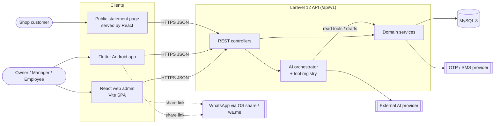
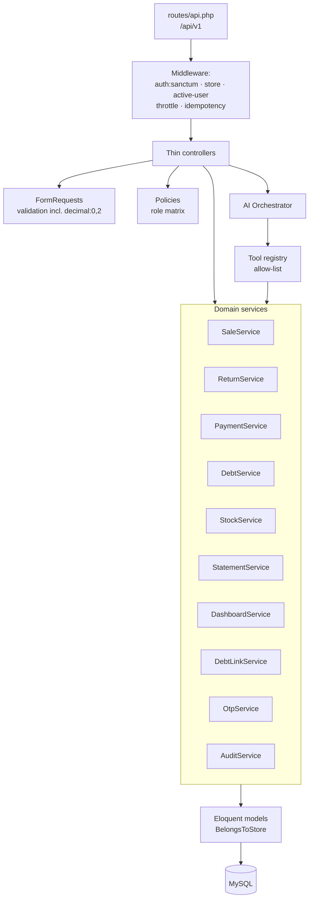
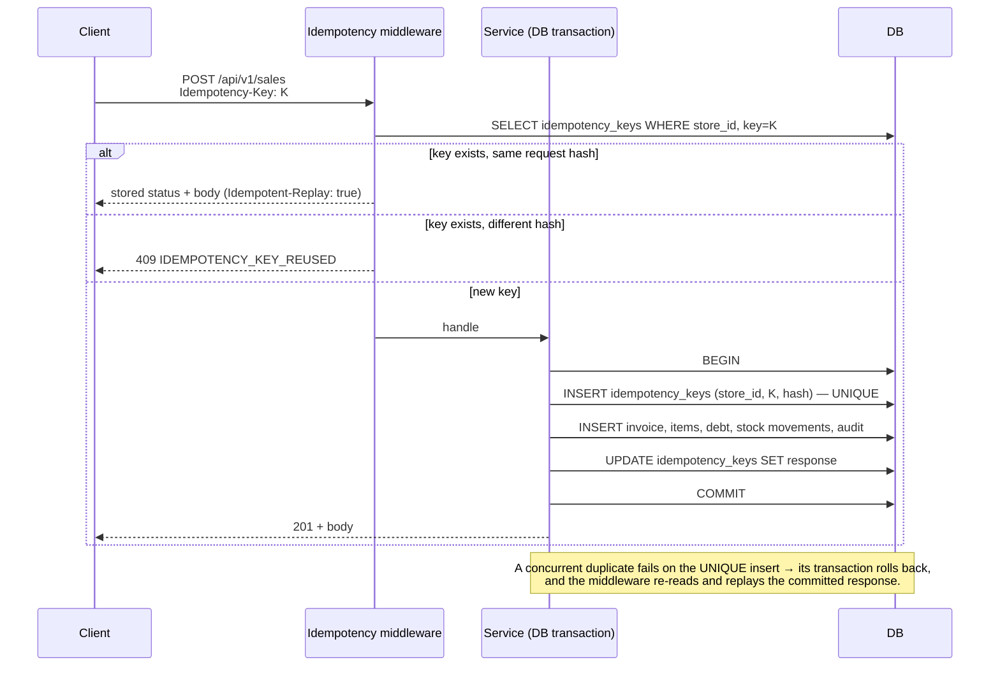
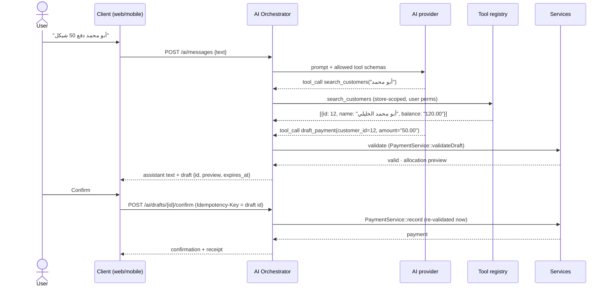
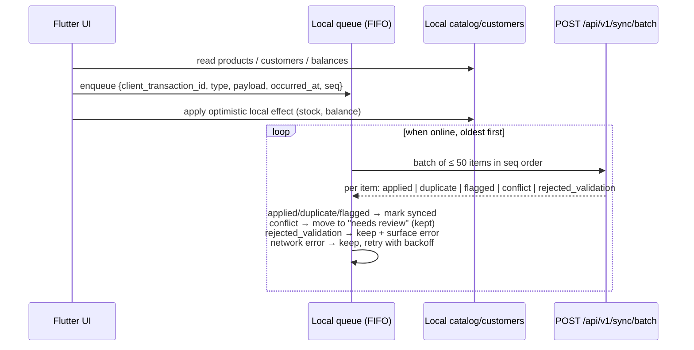
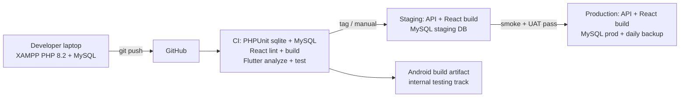

# 04 — System Architecture

> **Status: PROPOSED — AWAITING TEAM LEADER APPROVAL**
> Diagrams are Mermaid source in fenced blocks. They render on GitHub and in VS Code (Mermaid extension) and stay editable as text.
> Sections are labelled **[EXISTING — verified]** or **[PROPOSED]**.

## 1. Context



---

## 2. Backend

### 2.1 [EXISTING — verified]

| Area | Current state |
|---|---|
| Request pipeline | `routes/api.php` → middleware `auth:sanctum` + `store` (`EnsureUserHasStore`) → controller |
| Validation | FormRequests, including store-scoped `Rule::exists` |
| Isolation | `BelongsToStore` trait: route binding filtered by `store_id`, plus a `forStore()` scope. `ScopedThroughDebtStore` for payments. |
| Authorization | `UserPolicy` plus inline `abort_unless(hasRole())` checks |
| Business logic | Mostly **inside controllers**: invoices, debts, payments, pay-all, reversal. Services exist only for `AuthService` and `DashboardService`. |
| Transactions | `DB::transaction` + `lockForUpdate` in payment, pay-all, reversal and invoice update/delete |

### 2.2 [PROPOSED] Target layering

Existing controllers are not rewritten wholesale. Logic moves into services **only when a story touches it**, following the same transactional patterns.



**Rules:**

1. **Shared services:** Every financial write goes through one service method. Manual web, mobile, AI-confirmed and (in R2) sync writes all call the **same** method.
2. **Transaction scope:** Each service method opens **one** DB transaction covering:
   - the idempotency-key insert;
   - the business rows (invoice, items, debt, payment, stock movements);
   - the audit log.
   Either everything commits or nothing does.
3. **Lock order** (prevents deadlocks): `customer → debts (by id asc) → products (by id asc) → invoice`.
4. **Server-computed money:** All monetary arithmetic uses the `Money` helper (bcmath, 2-dp). Clients never send totals that the server trusts.
5. **Store scope:** `store_id` always comes from the authenticated user, never from the request body. `DashboardRequest` already prohibits `store_id`; the same pattern extends to all requests.

---

## 3. Financial and Synchronization Integrity Designs [PROPOSED]

### 3.1 Duplicate-request prevention (D-04)



**Failure behaviour:**

| Situation | Outcome |
|---|---|
| Crash before COMMIT | Nothing persisted, including the key, so the client retry executes normally |
| Crash after COMMIT but before the response reached the client | The retry receives the replayed response; no second write |
| UI button disabling | Defence in depth only; **never** the primary control |

### 3.2 Invoice (sale) creation — US-0501 / US-0502

**Transaction steps:**

1. Idempotency insert.
2. Lock each `product` row in id order. Validate `active`, `store_id`, and `quantity ≤ current_stock` (D-27).
3. Compute `line_total = qty × products.selling_price` (the DB price; the client price is ignored) and `total = Σ line_total`.
4. Validate `paid_amount`:
   - `0 ≤ paid_amount ≤ total`;
   - if `paid_amount < total`, `customer_id` is required (D-07);
   - credit-limit check (D-26).
5. Insert the invoice with `status=active` and `paid_amount`, and the items with `product_id`, `unit_price` and `line_total`.
6. Insert one `stock_movements` row per item (`type=sale`, negative quantity) and decrement `products.current_stock`.
7. If `remainder = total − paid_amount > 0`: insert a debt (`customer_id`, `amount=remainder`, `due_date?`).
8. Write an audit log entry if required (AI-confirmed sales always log).

**Failure behaviour:** Any validation failure returns 422 and rolls back everything. A DB error returns 500 with a correlation ID; it is logged, and nothing is partially written.

### 3.3 Void (replaces edit and delete) — US-0503

- **Preconditions:**
  - the caller is Owner/Manager;
  - `status=active`;
  - no non-reversed payments on the linked debt;
  - no returns.
- **Steps:**
  1. Set `status=voided`, `voided_by`, `voided_at` and `void_reason`.
  2. Write reverse `stock_movements` (`type=sale_void`).
  3. Cancel the debt: `status=cancelled`, `remaining=0`. The row is kept, not deleted.
  4. Write an audit log entry.
- **Result:** No FK problems (fixes DEF-01) and no history loss (fixes DEF-06).

### 3.4 Payments and reversal — US-0703

- **Recording:** Lock the debt, then validate `amount ≤ remaining` using bcmath. Insert the payment with `store_id`, `customer_id`, `created_by` and `client_transaction_id`. Then recompute `remaining = amount − return_credit − Σ non-reversed payments` and the status.
- **Reversal:**
  - Mark the payment (or the whole group, D-11) as reversed, with `reversed_by`, `reversed_at` and a reason.
  - Recompute `remaining` with the same formula.
  - Write an audit log entry.
- **Derived values:** `remaining` and `status` are always **recomputed from facts**, never incremented blindly. This is the existing pattern in the reversal code, extended to recording.

### 3.5 Returns — US-0601 (D-05)

**Transaction steps:**

1. Idempotency insert.
2. Lock the invoice, its items and its debt.
3. For each item, validate `qty ≤ sold − returned`.
4. Compute `return_value = Σ qty × original unit_price`, `debt_reduction = min(return_value, debt.remaining)` and `refund = return_value − debt_reduction`.
5. Insert `sale_returns` and `sale_return_items`, and increment `invoice_items.returned_quantity`.
6. Write `stock_movements` (`type=return`, positive) and increment stock.
7. Set `debt.return_credit += debt_reduction` and recompute `remaining`.
8. Write an audit log entry.

### 3.6 Stock invariant

`products.current_stock` is a cached value. The invariant `current_stock = Σ stock_movements.quantity` for each product is asserted by tests (TC-0402-03) and by a console command `hisbah:verify-stock` (US-0402) that reports drift.

### 3.7 Audit trail — US-0103

`audit_logs` is append-only. The application never updates or deletes rows. Actions logged:

- `invoice.voided`
- `payment.reversed`, `payment_group.reversed`
- `stock.adjusted`
- `user.role_changed`, `user.deactivated`, `invitation.created`
- `debt.opening_created`, `debt.opening_updated`
- `debt_link.generated`, `debt_link.revoked`
- `ai_draft.confirmed`
- `sale.returned`
- `sync.conflict_resolved` (R2)

### 3.8 AI drafts and confirmation — R1.1 (D-15, D-29)



**Guarantees:**

| Guarantee | Requirement |
|---|---|
| Tools run with the requesting user's identity, store and permissions | BR-13, AC-09 |
| The model never receives other stores' data | NFR-15 |
| Prices and balances come from the DB | FR-62, BR-14 |
| A provider error or timeout creates no draft and no record; the user gets a retry option | FR-63 |
| No `confirm` call means no write | BR-02 |

### 3.9 Offline synchronization — R2 (D-02, D-03, D-18, D-19)



- **Server side:** Each item is processed in its own transaction through the same services, using the item's `client_transaction_id` as the idempotency key. The batch stops at the first item that fails *technically* (not on business conflicts), which preserves FIFO.
- **FIFO alone is not enough.** Conflicts are handled per D-03:
  - sales are accept-and-flag;
  - payments that exceed the remaining debt are held as `sync_conflicts`;
  - nothing is discarded (BR-10).

---

## 4. Secure Debt Statement Access — R1.1 (D-17)

```mermaid
sequenceDiagram
    actor M as Manager
    participant API
    participant DB
    actor K as Customer (browser)
    M->>API: POST /customers/{id}/debt-link
    API->>DB: revoke previous active link; INSERT token_hash=sha256(uuid), expires_at=+30d
    API-->>M: https://app/s/{uuid} (plaintext shown once)
    M->>K: share via WhatsApp
    K->>API: GET /api/v1/public/statements/{uuid} (rate-limited)
    API->>DB: find by sha256(uuid), not revoked, not expired
    alt valid
        API-->>K: minimal statement (store name, customer display name, lines, totals)
    else invalid / expired
        API-->>K: 404 neutral message
    end
```

---

## 5. Clients

### 5.1 React web [EXISTING → PROPOSED]

| Area | Existing | Proposed |
|---|---|---|
| Routing | react-router 7: `/`, `/login`, `/register`, `/dashboard` | Authenticated layout with role-aware routes; public route `/s/:token` |
| Data | Raw `fetch` in `services/api.js` (DEF-12) | `apiClient` (fetch wrapper: base URL from `VITE_API_URL`, bearer token, `Idempotency-Key` for financial POSTs, error-envelope mapping, 401 → logout) + TanStack Query (D-21) |
| Styling | Global CSS + `[dir=rtl]` | CSS variables as design tokens ([06](06-ui-ux-and-screen-plan.md)); Arabic RTL default |
| Quality | oxlint, build | + `no-undef` rule, build in CI; component tests are optional in the MVP |

### 5.2 Flutter mobile [PROPOSED] (D-20)

```
lib/
  core/       (api_client, idempotency, auth_session, money_format, theme, router)
  features/
    auth/ pos/ catalog/ customers/ debts/ dashboard/ ai/ (R1.1) sync/ (R2)
      data/          (repositories, DTOs)
      application/   (Riverpod providers / controllers)
      presentation/  (screens, widgets)
```

**R1:** online-first. Every financial call carries an `Idempotency-Key` that is persisted until the server acknowledges it, so retries are safe. An offline banner blocks writes.

**R2:** adds the `sync/` feature: local store, queue, engine and indicator.

---

## 6. Deployment [PROPOSED] (D-25)



Environment, configuration, migration and rollback details are in [12](12-release-and-deployment-plan.md).

---

## 7. Architecture Decision Records (ADR) to Draft at Approval

| ADR | Topic | Source decision |
|---|---|---|
| ADR-001 | Staged releases | D-01 |
| ADR-002 | Idempotency-Key + same-transaction key table | D-04 |
| ADR-003 | Money as DECIMAL + bcmath + string JSON | D-09 |
| ADR-004 | Immutable invoices with void and return | D-06 |
| ADR-005 | Service layer for financial writes; lock ordering | §2.2 |
| ADR-006 | AI drafts-only boundary | D-29 |
| ADR-007 | Offline accept-and-flag / hold-for-review | D-03 |
| ADR-008 | Local storage technology | D-19 |
