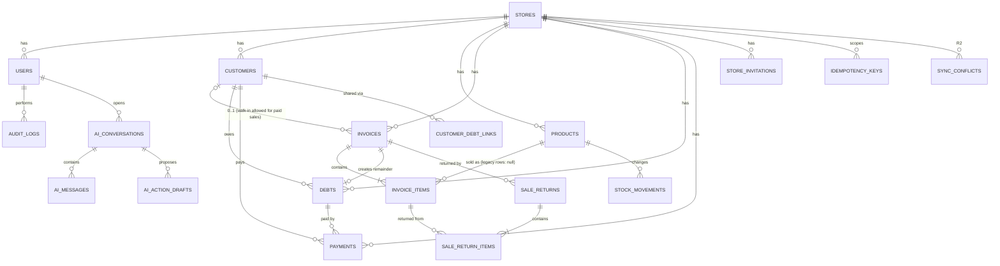

# 05 — Data Model and API Contracts

> **Status: PROPOSED — AWAITING TEAM LEADER APPROVAL**
> No migration, model or route has been changed. All schema changes below are **future additive migrations**; existing migrations are never edited.

## 1. ERD (existing + proposed)

**Legend:**

- `%% EXISTING`: tables present today.
- `%% NEW`: proposed tables.
- Columns marked `(new)` are proposed additions to existing tables.



### 1.1 Changes to existing tables

| Table | Add (nullable unless stated) | Change | Backfill | Story |
|---|---|---|---|---|
| `stores` | `status` (`pending_verification`/`active`/`suspended`, default `active` for existing rows); `phone_verified_at`; `timezone` (default `Asia/Hebron`, D-23) | — | Existing stores → `active` | US-0107, US-0203 |
| `users` | `status` (`active`/`inactive`, default `active`); `deactivated_at` | Role `owner` cannot be assigned via the API (policy) | — | US-0105 |
| `customers` | `credit_limit` DECIMAL(12,2) | — | null = no limit | US-0305 |
| `invoices` | `paid_amount` DECIMAL(12,2) NOT NULL default 0; `status` (`active`/`voided`) NOT NULL default `active`; `voided_at`, `voided_by`, `void_reason`; `created_by`; `client_transaction_id` | `customer_id` → nullable (D-07) | Cash invoices: `paid_amount = total_amount`. Credit: `0`. | US-0501, US-0503 |
| `invoice_items` | `product_id` FK → products (restrict); `returned_quantity` INT UNSIGNED default 0 | Rename semantics: `total` = line_total (no rename) | Legacy rows keep `product_id = null` | US-0501, US-0601 |
| `debts` | `customer_id` FK (NOT NULL after backfill); `due_date` DATE; `return_credit` DECIMAL(12,2) default 0 | `status` adds `cancelled` | `customer_id` from `invoices.customer_id` | US-0701 |
| `payments` | `store_id` FK (NOT NULL after backfill); `customer_id` FK; `reversed_by` FK users; `client_transaction_id` | — | Through `debt` → `store_id`, `invoice.customer_id` | US-0703 |

### 1.2 New tables

| Table | Key columns | Constraints and indexes | Story |
|---|---|---|---|
| `products` | `id`, `store_id`, `name`, `barcode`, `selling_price` DEC(12,2), `cost_price` DEC(12,2) null, `current_stock` INT, `minimum_stock` INT default 5, `status`, timestamps | `UNIQUE(store_id, barcode)` (barcode nullable); `INDEX(store_id, name)`; `CHECK selling_price > 0` (app-level on sqlite) | US-0401 |
| `stock_movements` | `id`, `store_id`, `product_id`, `type` (`opening`, `sale`, `sale_void`, `return`, `adjustment_in`, `adjustment_out`), `quantity` (signed INT), `balance_after`, `reason`, `reference_type`, `reference_id`, `created_by`, `created_at` | `INDEX(product_id, created_at)`; append-only | US-0402 |
| `sale_returns` | `id`, `store_id`, `invoice_id`, `customer_id` null, `total_amount`, `debt_reduction_amount`, `refund_amount`, `refund_method`, `reason`, `created_by`, `client_transaction_id`, timestamps | `INDEX(invoice_id)` | US-0601 |
| `sale_return_items` | `id`, `sale_return_id`, `invoice_item_id`, `product_id`, `quantity`, `unit_price`, `amount` | FK restrict | US-0601 |
| `audit_logs` | `id`, `store_id`, `user_id`, `action`, `entity_type`, `entity_id`, `metadata` JSON, `ip`, `user_agent`, `created_at` | `INDEX(store_id, created_at)`; `INDEX(entity_type, entity_id)`; append-only | US-0103 |
| `idempotency_keys` | `id`, `store_id`, `user_id`, `key` (uuid), `request_hash`, `method_path`, `response_status`, `response_body` JSON, `created_at` | **`UNIQUE(store_id, key)`**; pruned after ≥ 30 days | US-0101 |
| `otp_verifications` | `id`, `phone`, `purpose`, `code_hash`, `attempts`, `expires_at`, `verified_at`, `consumed_at`, `ip`, `created_at` | `INDEX(phone, purpose)` | US-0203 |
| `customer_debt_links` | `id`, `store_id`, `customer_id`, `token_hash` (sha256), `expires_at`, `revoked_at`, `created_by`, `last_accessed_at`, `created_at` | `UNIQUE(token_hash)`; at most one active link per customer (enforced in the service) | US-0901 |
| `ai_conversations` | `id`, `store_id`, `user_id`, `status`, `started_at`, `ended_at` | `INDEX(store_id, user_id)` | US-1001 |
| `ai_messages` | `id`, `conversation_id`, `sender` (`user`/`assistant`/`tool`), `content`, `type`, `sequence`, `created_at` | `INDEX(conversation_id, sequence)`; retained 90 days (D-15) | US-1001 |
| `ai_action_drafts` | `id` (uuid), `conversation_id`, `user_id`, `store_id`, `action_type` (`payment`/`invoice`), `payload` JSON, `validation_status`, `confirmation_status` (`pending`/`confirmed`/`cancelled`/`expired`), `expires_at`, `executed_at`, `result_type`, `result_id` | `INDEX(store_id, user_id, confirmation_status)` | US-1003 |
| `sync_conflicts` *(R2)* | `id`, `store_id`, `device_id`, `client_transaction_id`, `type`, `payload` JSON, `reason`, `status` (`open`/`resolved`), `resolution`, `resolved_by`, `resolved_at` | `UNIQUE(store_id, client_transaction_id)` | US-1101 |

`PaymentGroup` (in the SRS ERD) stays a **UUID column** (`payments.payment_group_id`), as implemented. No table is needed for the MVP.

### 1.3 Integrity rules

1. **Store ownership:** Every store-owned row carries `store_id`. Child-row FKs must point to rows of the **same store**. This is validated in the service and covered by tests (SRS §8.3).
2. **Product reference:** `invoice_items.product_id` must belong to `invoices.store_id`.
3. **Sale totals:** `invoices.total_amount = Σ invoice_items.total` and `0 ≤ paid_amount ≤ total_amount`.
4. **Debt for unpaid sales:** If `paid_amount < total_amount` and `status=active`, exactly one debt exists with `amount = total − paid` and the same `customer_id`.
5. **Debt balance:** `debts.remaining = amount − return_credit − Σ non-reversed payments.amount`, which must be ≥ 0.
6. **Debt status is derived:**
   - `paid` when remaining = 0;
   - `partially_paid` when 0 < remaining < amount − return_credit;
   - `unpaid` otherwise;
   - `cancelled` when the invoice is voided.
7. **Stock:** `products.current_stock = Σ stock_movements.quantity`, and it is ≥ 0 for online writes.
8. **Returns:** `invoice_items.returned_quantity ≤ quantity`.
9. **Immutable rows:** audit logs and stock movements are append-only; financial rows are never hard-deleted.
10. **Money format:** all money is `DECIMAL(12,2)` with input validation `decimal:0,2`, and is serialized as a string.

---

## 2. API Conventions (`/api/v1`)

| Topic | Convention |
|---|---|
| Base path | `/api/v1` (D-22). The public statement is at `/api/v1/public/statements/{token}`. |
| Auth | `Authorization: Bearer <sanctum token>`. Tokens expire after 30 days (configurable). Login is throttled to 5/min per email+IP. |
| Store scope | Always taken from the token's user. A `store_id` in a request body is **prohibited**. |
| Idempotency | **Required** (`Idempotency-Key: <uuid v4>`) on: `POST /sales`, `POST /sales/{id}/void`, `POST /sales/{id}/returns`, `POST /payments`, `POST /payments/{id}/reverse`, `POST /payment-groups/{id}/reverse`, `POST /customers/{id}/debts/pay-all`, `POST /debts` (opening), `POST /stock-adjustments`, `POST /ai/drafts/{id}/confirm`. Missing → 428. Reused with a different body → 409. |
| Money | Strings with 2 decimals (`"12.50"`). Responses include `meta.currency = "ILS"`; clients display `₪`. |
| Timestamps | ISO-8601 UTC in responses. Responses that need business dates also include `store_timezone`. |
| Pagination | `?page=&per_page=` (max 50). The response has `data[]`, `meta{current_page, per_page, total}` and `links`. |
| Language | `Accept-Language: ar` (default) or `en` for messages. Codes are stable English constants. |

### 2.1 Error envelope

```json
{
  "message": "مبلغ الدفعة أكبر من المبلغ المتبقي",
  "code": "PAYMENT_EXCEEDS_REMAINING",
  "errors": { "amount": ["…"] },
  "correlation_id": "01J…"
}
```

| HTTP | When | Example codes |
|---|---|---|
| 401 | Missing, invalid or expired token | `UNAUTHENTICATED` |
| 403 | Role/policy denial; inactive user; unverified store | `FORBIDDEN`, `USER_INACTIVE`, `STORE_NOT_VERIFIED` |
| 404 | Not found **or belongs to another store** (never reveals existence) | `NOT_FOUND` |
| 409 | Idempotency key reused with a different payload; state conflict | `IDEMPOTENCY_KEY_REUSED`, `INVOICE_ALREADY_VOIDED` |
| 422 | Validation or business rule | `INSUFFICIENT_STOCK`, `CREDIT_LIMIT_EXCEEDED`, `RETURN_QTY_EXCEEDS_SOLD` |
| 428 | Financial endpoint without an `Idempotency-Key` | `IDEMPOTENCY_KEY_REQUIRED` |
| 429 | Throttled | `TOO_MANY_REQUESTS` |
| 500 | Unexpected error. A generic message plus a `correlation_id`; details only in the logs. | `SERVER_ERROR` |

---

## 3. Endpoint Catalogue

Status column: **E** = exists today (path moves to `/v1`) · **X** = exists, behaviour changes · **N** = new.

| Area | Method & path | Status | Roles (see §6) | Story |
|---|---|---|---|---|
| Auth | `POST /auth/otp/request`, `POST /auth/otp/verify` | N | public (throttled) | US-0203 |
| | `POST /register` (requires a verified OTP token) | X | public | US-0201, US-0203 |
| | `POST /login`, `POST /logout`, `GET /me` | E (+ throttle, expiry) | any | US-0104, US-0202 |
| | `POST /register/invitation` | E | public | — |
| Staff | `GET /users`, `PATCH /users/{id}/role`, `POST /users/{id}/deactivate`, `POST /invitations` | X (`DELETE` → deactivate) | Owner | US-0105, US-0204 |
| Customers | `GET/POST /customers`, `GET/PATCH /customers/{id}`, `DELETE /customers/{id}` (soft, guarded) | E (+ `credit_limit`) | see §6 | US-0301, US-0305 |
| | `GET /customers/{id}/summary`, `GET /customers/{id}/statement?from&to` | N | all | US-0302 |
| | `GET /customers/{id}/debts`, `POST /customers/{id}/debts/pay-all` | E (+ idempotency) | see §6 | US-0703 |
| | `POST /customers/{id}/debt-link`, `DELETE /customers/{id}/debt-link` | N | Owner, Manager | US-0901 |
| Products | `GET/POST /products`, `GET/PATCH /products/{id}`, `POST /products/{id}/deactivate`, `GET /products/lookup?barcode=` | N | read: all; write: Owner, Manager | US-0401 |
| Stock | `POST /stock-adjustments`, `GET /products/{id}/movements`, `GET /products/low-stock` | N | adjust: Owner, Manager | US-0402, US-0403 |
| Sales | `POST /sales` | N (replaces `POST /invoices`) | all | US-0501, US-0502 |
| | `GET /sales`, `GET /sales/{id}` | X (was `/invoices`) | all | US-0504 |
| | `PATCH /sales/{id}` (notes only) | X | Owner, Manager | US-0503 |
| | `POST /sales/{id}/void` | N (replaces `DELETE`) | Owner, Manager | US-0503 |
| Returns | `POST /sales/{id}/returns`, `GET /returns`, `GET /returns/{id}` | N | Owner, Manager | US-0601 |
| Debts | `GET /debts?status=&due=today\|week\|overdue&sort=balance`, `GET /debts/{id}`, `POST /debts` (opening, + `due_date`), `PATCH/DELETE /debts/{id}` (opening, unpaid only) | X | see §6 | US-0701, US-0702 |
| Payments | `GET /payments?customer_id=&invoice_id=`, `POST /payments`, `POST /payments/{id}/reverse`, `POST /payment-groups/{id}/reverse` | X | see §6 | US-0703 |
| Dashboard | `GET /dashboard?period=today\|this_week\|this_month\|this_year` | X (+ collections breakdown, low stock, insights) | all | US-0801 |
| Public | `GET /public/statements/{token}` | N | public (throttled, 30/min/IP) | US-0901 |
| AI | `POST /ai/conversations`, `POST /ai/messages`, `GET /ai/conversations/{id}`, `POST /ai/drafts/{id}/confirm`, `POST /ai/drafts/{id}/cancel` | N | all (tools filtered by role) | US-1001–US-1004 |
| Sync (R2) | `POST /sync/batch`, `GET /sync/bootstrap?since=`, `GET/POST /sync/conflicts…` | N | all; conflict resolution: Owner, Manager | US-1101, US-1106 |

### 3.1 Example — `POST /api/v1/sales` (US-0501 / US-0502)

**Request** (headers: `Idempotency-Key: 6f1c…`):

```json
{
  "customer_id": 12,
  "items": [ { "product_id": 301, "quantity": 3 } ],
  "paid_amount": "20.00",
  "payment_method": "cash",
  "due_date": "2026-11-01",
  "notes": null
}
```

**201 response:**

```json
{
  "data": {
    "id": 9001, "status": "active", "customer": { "id": 12, "name": "أبو محمد" },
    "items": [ { "product_id": 301, "name": "مياه 6×1.5L", "quantity": 3, "unit_price": "15.00", "line_total": "45.00" } ],
    "total_amount": "45.00", "paid_amount": "20.00",
    "debt": { "id": 77, "amount": "25.00", "remaining_amount": "25.00", "due_date": "2026-11-01", "status": "unpaid" },
    "created_at": "2026-10-20T08:14:03Z"
  },
  "meta": { "currency": "ILS" }
}
```

**Rules:**

- The client sends **no prices**. The server uses `products.selling_price`.
- `customer_id` is required when `paid_amount < total`.
- `payment_method` is required when `paid_amount > 0`.
- `due_date` is allowed only when a debt results.

### 3.2 Example — `POST /api/v1/sales/{id}/returns` (US-0601)

```json
{ "items": [ { "invoice_item_id": 5501, "quantity": 1 } ], "reason": "منتج تالف", "refund_method": "cash" }
```

The response includes `total_amount`, `debt_reduction_amount`, `refund_amount`, and the updated debt.

---

## 4. Idempotency and Synchronization Contract

### 4.1 R1 (online)

1. **Key generation:** The client generates a UUIDv4 **when the user confirms the action** and stores it with the pending request.
2. **Retries:** Any retry, whether a network error, a timeout or an app restart, re-sends the **same** key and payload.
3. **Completion:** The client discards the key only after a 2xx or a final 4xx response (not 409/428).
4. **Server guarantees:** one business effect per `(store_id, key)`, and an identical replayed response.

### 4.2 R2 (offline)

`POST /sync/batch` with up to 50 items, ordered by device `seq`:

```json
{
  "device_id": "a3f…",
  "items": [
    { "client_transaction_id": "uuid", "seq": 41, "type": "sale", "occurred_at": "2026-12-01T09:00:00+02:00", "payload": { "...": "same shape as POST /sales" } }
  ]
}
```

Response, one entry per item, in the same order:

```json
{
  "results": [
    { "client_transaction_id": "uuid", "status": "applied|duplicate|flagged|conflict|rejected_validation", "server_id": 9002, "flags": ["NEGATIVE_STOCK"], "error": null }
  ]
}
```

**Processing rules:**

- Items are processed **in order**.
- A technical failure (5xx) stops the batch; the client retries from that item.
- Business outcomes (`flagged`, `conflict`, `rejected_validation`) do **not** stop later items **of other entities**. Exception: a payment whose debt depends on an earlier item from the same device that was rejected is itself marked `conflict`.
- `occurred_at` is preserved as the business time (BR-08).
- Supported types in R2: `sale`, `payment` (CR-02).

---

## 5. AI Tool Contracts (R1.1)

All tools:

- run with the authenticated user's `store_id` and role;
- return **only** the fields listed;
- return no more than 20 rows.

| Tool | Kind | Input | Output | Permission |
|---|---|---|---|---|
| `get_sales_summary` | read | `period` ∈ today/this_week/this_month/this_year | totals: sales, cash, credit, collections, invoices_count | all |
| `get_total_outstanding_debt` | read | — | `total_remaining`, `debtors_count`, `overdue_total` | all |
| `search_customers` | read | `query` (name/phone fragment) | `[{id, name, phone_masked, balance}]` | all |
| `get_customer_balance` | read | `customer_id` | `{name, total_debt, paid, returned, remaining, overdue}` | all |
| `get_low_stock_products` | read | `limit` ≤ 20 | `[{id, name, current_stock, minimum_stock}]` | all |
| `search_products` | read | `query` or `barcode` | `[{id, name, selling_price, current_stock}]` | all |
| `get_daily_summary` | read | `date` (default today, store timezone) | Composite of the above for the narrative summary (FR-52) | all |
| `draft_payment` | **draft** | `customer_id`, `amount`, `method` | `draft{id, preview{customer, amount, allocation[], remaining_after}, expires_at}` | roles allowed to `POST /payments` |
| `draft_invoice` | **draft** | `customer_id?`, `items[{product_id, quantity}]`, `paid_amount`, `due_date?` | `draft{id, preview{lines (DB prices), total, paid, debt}, expires_at}` | roles allowed to `POST /sales` |

**Guardrails (D-29):**

- No tool accepts a price, balance or `store_id`.
- Unknown or ambiguous entities return candidates; the model must ask the user.
- Draft tools **never write business rows**. Confirmation is a separate, explicit HTTP call by the user.
- A tool not on the allow-list is rejected and logged.

---

## 6. Authorization Matrix

Proposed under D-12 / CR-10. Enforced by Policies; every cell is covered by a test (TC-0105-*).

| Action | Owner | Manager | Employee |
|---|---|---|---|
| View dashboard, customers, products, sales, debts, payments | ✔ | ✔ | ✔ |
| Create/update customer | ✔ | ✔ | ✔ |
| Delete (soft) customer without financial history | ✔ | ✔ | ✖ |
| Set customer credit limit | ✔ | ✔ | ✖ |
| Create/update/deactivate product | ✔ | ✔ | ✖ |
| Stock adjustment | ✔ | ✔ | ✖ |
| Create sale (cash/credit/partial) | ✔ | ✔ | ✔ |
| Void sale | ✔ | ✔ | ✖ |
| Process return | ✔ | ✔ | ✖ |
| Record payment | ✔ | ✔ | ✔ |
| Pay-all for a customer | ✔ | ✔ | ✔ *(proposed: aligned with single payment; currently Owner/Manager only — TL to confirm under D-12)* |
| Reverse payment / payment group | ✔ | ✔ | ✖ |
| Create / edit / delete opening debt | ✔ | ✔ | ✖ |
| Generate / revoke secure debt link | ✔ | ✔ | ✖ |
| Invite staff, change roles, deactivate users | ✔ | ✖ | ✖ |
| Resolve sync conflicts (R2) | ✔ | ✔ | ✖ |
| AI read tools | ✔ | ✔ | ✔ |
| AI payment / invoice drafts | Same as the underlying manual action | | |
| Assign role `owner` | ✖ (nobody) | ✖ | ✖ |
