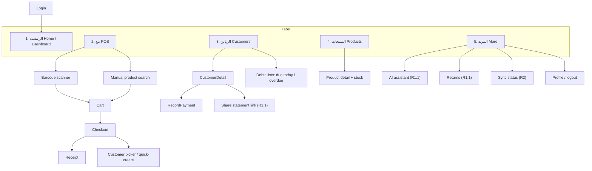
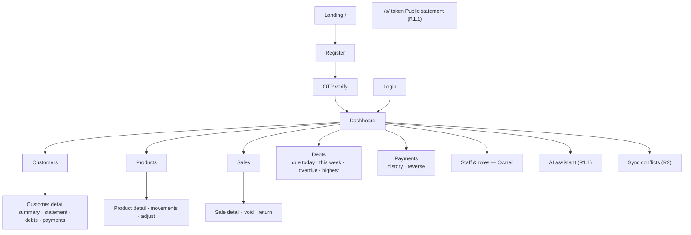
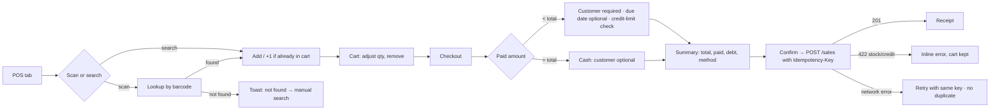

# 06 — UI/UX and Screen Plan

> **Status: PROPOSED — AWAITING TEAM LEADER APPROVAL**
> **No Figma file has been created.** No Figma integration was connected or verified in this session (assumption A-06). This document is an implementation-ready specification. §9 describes how to produce Figma screens from it.

## 1. Principles

1. **Platform roles:**
   - **Mobile** is the till: fast, one-handed, few taps.
   - **Web** is the back office: review, configuration, corrections and reports.
2. **Arabic-first, RTL by default.** English is secondary (SRS §9.4). Numbers use Western digits for money, matching receipts and banking apps; the TL can change this (UI-D1).
3. **Money is always shown with `₪` and exactly 2 decimals** (`₪ 45.00`). Debt states use colour **plus** text, never colour alone.
4. **Every screen has four states:** loading, empty, error (with retry), and success.
5. **Financial actions always show a summary before commit.** The commit button names the action, for example "تأكيد البيع ₪ 45.00", never just "OK".
6. **Visible states:** paid / partially paid / unpaid / due today / overdue / voided / low stock / offline (R2) / pending-sync (R2).

---

## 2. Information Architecture

### 2.1 Mobile (Flutter): bottom navigation with 5 tabs

### 2.2 Web (React): right-side navigation in RTL

---

## 3. Screen Inventory

**Priority score:**

- **F** = frequency: daily, weekly or rare.
- **C** = business criticality: High, Medium or Low.
- **Rank:** 1 is built and designed first.

### 3.1 Mobile

| ID | Screen | Purpose | Roles | F | C | Rank | Release | Story | Traces |
|---|---|---|---|---|---|---|---|---|---|
| SCR-M-01 | Login | Authenticate | all | weekly | H | 4 | R1 | US-1301, US-0205 | FR-03, UC-03 |
| SCR-M-02 | POS: cart | Scan/search, quantities, total | all | **daily, many** | **H** | **1** | R1 | US-0505 | FR-17, FR-18, FR-23, UC-08, UC-10 |
| SCR-M-03 | Barcode scanner (overlay) | Camera scan; repeat scan increments | all | daily | H | 1 | R1 | US-0505 | FR-17, FR-18, AC-01, AC-02 |
| SCR-M-04 | Checkout | Cash / credit / partial, customer, due date, confirm | all | daily | H | 2 | R1 | US-0506 | FR-24–27, UC-10, UC-11 |
| SCR-M-05 | Customer picker / quick-create | Find or create a customer during checkout | all | daily | H | 2 | R1 | US-0304 | FR-10, UC-05 |
| SCR-M-06 | Sale receipt | Success, sale number, debt created | all | daily | M | 2 | R1 | US-0506 | FR-29 |
| SCR-M-07 | Customers list | Search; balance badge | all | daily | H | 3 | R1 | US-0304 | FR-10, FR-14 |
| SCR-M-08 | Customer detail | Balance, open debts, recent payments | all | daily | H | 3 | R1 | US-0705 | FR-12, FR-14 |
| SCR-M-09 | Record payment | Amount, method, confirm summary | all | daily | H | 3 | R1 | US-0705 | FR-38, UC-13 |
| SCR-M-10 | Home / dashboard | Today's sales, collections, debt, alerts | all | daily | M | 5 | R1 | US-0803 | FR-46, FR-47, UC-17 |
| SCR-M-11 | Products list + low stock | Search, stock badge | all | daily | M | 5 | R1 | US-0406 | FR-19, FR-22 |
| SCR-M-12 | AI assistant chat (text + voice) | Ask, draft, preview, confirm | all | daily | M | 6 | R1.1 | US-1006, US-1007 | FR-49–60, UC-18–21 |
| SCR-M-13 | AI draft preview sheet | Exact operation + Confirm/Cancel | all | daily | H | 6 | R1.1 | US-1006 | FR-56, FR-57, BR-02 |
| SCR-M-14 | Share statement link | Generate + share via WhatsApp | Owner/Mgr | weekly | M | 7 | R1.1 | US-0903 | FR-43, FR-44, UC-16 |
| SCR-M-15 | Return | Pick sale → items/qty → summary | Owner/Mgr | weekly | M | 7 | R1.1 | US-0603 | FR-32, UC-12 |
| SCR-M-16 | Sync status | Pending / synchronizing / synced / review items | all | daily | H | 8 | R2 | US-1104 | FR-67 |
| SCR-M-17 | Stock adjustment | +/− with reason | Owner/Mgr | weekly | M | 8 | R2 | US-0407 | FR-20 |

### 3.2 Web

| ID | Screen | Purpose | Roles | F | C | Rank | Release | Story | Traces |
|---|---|---|---|---|---|---|---|---|---|
| SCR-W-01 | Login | Authenticate | all | weekly | H | 1 | R1 | US-0202 | FR-03, UC-03 |
| SCR-W-02 | Register | Owner + store details | public | rare | H | 2 | R1 | US-0201 | FR-01, UC-01 |
| SCR-W-03 | OTP verification | Enter code, resend, errors | public | rare | H | 2 | R1 | US-0203 | FR-02, UC-02 |
| SCR-W-04 | App shell | Nav, store/role header, logout | all | daily | H | 1 | R1 | US-1201 | FR-05, FR-06 |
| SCR-W-05 | Dashboard | Period filter, KPI cards, insight cards, simple charts | all | daily | H | 3 | R1 | US-0802 | FR-46–48, AC-10 |
| SCR-W-06 | Customers list | Search, balance, overdue badge, create | all | daily | H | 4 | R1 | US-0301 | FR-10, FR-11 |
| SCR-W-07 | Customer detail | Summary, chronological statement, debts, payments, credit limit | all | daily | H | 4 | R1 | US-0303 | FR-12–14, UC-06 |
| SCR-W-08 | Products list | Search, barcode, stock, low-stock filter | all | daily | H | 5 | R1 | US-0405 | FR-15, FR-16, FR-22 |
| SCR-W-09 | Product form / detail | Create/edit, movements history, adjust stock | Owner/Mgr | weekly | H | 5 | R1 | US-0405 | FR-15, FR-20, FR-21 |
| SCR-W-10 | Sales list | Filters: date, type, status | all | daily | M | 6 | R1 | US-0504 | FR-29 |
| SCR-W-11 | Sale detail | Lines, debt, payments, returns; Void; Return | all (actions Owner/Mgr) | daily | H | 6 | R1 | US-0504, US-0503, US-0602 | FR-29–33 |
| SCR-W-12 | Return dialog | Item quantities, preview (debt reduction / refund), confirm | Owner/Mgr | weekly | H | 6 | R1 | US-0602 | FR-32, FR-33, AC-04 |
| SCR-W-13 | Debts | Tabs: due today / this week / overdue / highest balance / all; opening debt | all | daily | H | 7 | R1 | US-0704 | FR-34–37, FR-41, FR-42 |
| SCR-W-14 | Payments | History with filters; record; reverse (single/group) | all (reverse Owner/Mgr) | daily | H | 7 | R1 | US-0704 | FR-38–40 |
| SCR-W-15 | Staff & roles | Invite, list, change role, deactivate | Owner | rare | M | 8 | R1 | US-0204 | FR-08, FR-09, UC-04 |
| SCR-W-16 | AI assistant | Chat + draft preview/confirm | all | daily | M | 9 | R1.1 | US-1005 | FR-49–59 |
| SCR-W-17 | Public statement `/s/:token` | Read-only statement for the customer | public | weekly | M | 9 | R1.1 | US-0902 | FR-43, NFR-07, UC-06 |
| SCR-W-18 | Sync conflicts | Review flagged/conflict items, resolve | Owner/Mgr | weekly | H | 10 | R2 | US-1106 | BR-10 |

> **Excluded on purpose:**
>
> - **Web POS / sale creation** (D-30).
> - **Mobile staff management** (rare, owner-only, web is sufficient).
> - **Mobile opening-debt entry** (rare back-office task).
>
> Each can be added later through a change request if needed.

---

## 4. Core User Flows

### 4.1 Mobile sale with barcode (UC-08, UC-10, UC-11)

**Target:** after the last scan, the sale is committed in **≤ 4 taps** for a walk-in cash sale: Checkout → (paid = total pre-filled) → Confirm → Done.

### 4.2 Record payment (UC-13)

1. Customers list → Customer detail → Record payment.
2. Enter an amount (pre-filled options: full remaining, or a custom amount) and a method.
3. A summary is shown: "Remaining after: ₪ x".
4. Confirm → `POST /payments` with an Idempotency-Key.
5. The success screen shows the new balance.

### 4.3 Return (UC-12, web in R1)

1. Sale detail → Return.
2. Choose items and quantities (max = sold − returned).
3. A preview shows the return value, debt reduction and cash refund.
4. Enter a reason → Confirm.
5. Sale detail now shows the return and the updated debt and stock.

### 4.4 AI payment (UC-20, R1.1)

1. The user types or speaks: "أبو محمد دفع 50".
2. The assistant asks for clarification if more than one customer matches.
3. A preview sheet shows the customer, the amount, the debts affected and the remaining-after.
4. **Confirm** → executed, then a receipt message. **Cancel** → nothing is written.

### 4.5 Secure link share (UC-16, R1.1)

1. Customer detail → "Share statement".
2. Generate (this revokes the previous link) → the share sheet opens with a prefilled Arabic message and the link.
3. The link shows its expiry date; it can be revoked from the same screen.

---

## 5. Component and Design-System Specification

### 5.1 Tokens

| Token | Value (proposal) | Use |
|---|---|---|
| `color.primary` | `#0F8A7E` (teal, from the SRS cover) | Primary actions, brand |
| `color.ink` | `#0B1A2B` | Text |
| `color.surface` / `color.bg` | `#FFFFFF` / `#F5F7F8` | Cards / page |
| `color.success` | `#1E8E3E` | Paid |
| `color.warning` | `#B26A00` | Partially paid, due today, low stock |
| `color.danger` | `#C62828` | Overdue, errors, voided |
| `color.info` | `#1565C0` | Pending sync (R2) |
| `font.family` | "IBM Plex Sans Arabic" or "Noto Sans Arabic" (TL choice, UI-D2), fallback system | Arabic + Latin |
| `font.size` | 14 / 16 (body) / 20 / 24 / 32 | Minimum body 16 px on mobile |
| `space` | 4, 8, 12, 16, 24, 32 | Spacing scale |
| `radius` | 8 (inputs), 12 (cards) | — |
| `touch.min` | 48 × 48 dp | Mobile targets |

All text/background colour pairs must reach WCAG AA contrast (4.5:1 for body text). This is verified in US-1501.

### 5.2 Shared components (web and mobile names aligned)

| Component | Notes |
|---|---|
| `MoneyText` | Formats `"45.00"` as `₪ 45.00`; tabular numerals; negative and refund variants |
| `StatusBadge` | `paid`, `partially_paid`, `unpaid`, `due_today`, `overdue`, `voided`, `low_stock`, `pending_sync`; each with icon + text |
| `ConfirmSummary` | Key/value summary + named commit button + cancel; used by sale, payment, return, void, reversal, AI draft |
| `EntityPicker` | Search-as-you-type for customers and products; shows "create new" |
| `QuantityStepper` | −/+ with direct input; clamps to available stock |
| `PeriodFilter` | today / this week / this month / this year |
| `KpiCard`, `InsightCard` | Dashboard |
| `DataTable` (web) | Sorting, pagination, empty state |
| `EmptyState`, `ErrorState` (retry), `Skeleton` | Mandatory per screen |
| `OfflineBanner` | R1: "No connection — sales need internet". R2: queue-aware. |
| `ReasonDialog` | Required reason for void, reversal, adjustment and return |

---

## 6. Wireframe Descriptions (primary flows)

**SCR-M-02 POS cart (RTL), top to bottom:**

1. Header: store name; offline indicator.
2. A large **scan button** (camera icon) plus a search field.
3. Cart list. Each row shows the product name, the unit price (`MoneyText`), a `QuantityStepper` and the line total. Swiping removes a row.
4. Sticky footer: item count, a **large total** and a "الدفع" (Checkout) primary button.
5. Empty state: "امسح منتجاً للبدء" with the scan button.

**SCR-M-04 Checkout:**

1. Total (large).
2. Segmented control: كاش كامل / جزئي / دين.
3. Paid amount field, pre-filled with the total for cash.
4. Customer picker: hidden for full cash with an optional "add customer" link; required otherwise.
5. Due date (shown only when a debt results).
6. Payment method chips.
7. `ConfirmSummary` (total, paid, debt) → "تأكيد البيع".

**SCR-W-07 Customer detail:**

1. Header: name, phone, credit limit, "Share statement" (R1.1).
2. KPI row: total debt, paid, returned, remaining, overdue.
3. Tabs: Statement (chronological, with running balance), Debts, Payments, Sales.
4. Actions: Record payment, Add opening debt (Owner/Manager).

**SCR-W-11 Sale detail:**

1. Status badge (active/voided).
2. Lines with returned quantities.
3. Payment summary and debt card.
4. Returns history.
5. Actions (role-gated): Return, Void. Void is disabled with a tooltip explaining why when payments or returns exist.

**SCR-W-05 Dashboard:**

1. Period filter.
2. KPI cards: sales (cash/credit), collections (at sale + repayments), new debt, outstanding debt, customers, invoices, low-stock count.
3. Insight cards: overdue (count + amount), due today, low stock list, top 5 balances.
4. Bar charts: daily or monthly sales and collections, drawn with CSS bars (no chart library, D-21).

**SCR-M-13 AI draft preview (R1.1):**

- A bottom sheet titled with the action type.
- Exact fields from the server preview, with prices taken from the DB.
- Expiry countdown.
- Two buttons of equal size, "تأكيد" and "إلغاء". Confirm uses a primary style; there is no default focus on Confirm.

---

## 7. UI Acceptance Criteria

Linked to FR/UC IDs. Each is verified by the TC listed in [09](09-testing-and-definition-of-done.md).

| UI-AC | Criterion | Traces |
|---|---|---|
| UI-AC-01 | Scanning the same barcode twice shows one cart line with quantity 2 | FR-18, AC-02 |
| UI-AC-02 | The checkout commit button shows the exact amount and is disabled while submitting; a retry after a timeout reuses the same Idempotency-Key | FR-23, FR-66, D-04 |
| UI-AC-03 | Customer picker is required whenever paid < total, and the error is shown inline | FR-25, FR-26, D-07 |
| UI-AC-04 | Every money value displays `₪` with 2 decimals | FR-45 |
| UI-AC-05 | Debt status is shown as text + colour + icon (not colour alone) | §9.4, NFR-14 |
| UI-AC-06 | Every list screen has loading, empty and error-with-retry states | §9.4 |
| UI-AC-07 | Void and Return actions are hidden or disabled for Employees, with a server 403 as backstop | FR-06, D-12 |
| UI-AC-08 | Return dialog prevents quantity > returnable and previews debt reduction and refund | FR-32, FR-33 |
| UI-AC-09 | AI write actions always show a preview sheet; cancel closes it with no request to the confirm endpoint | FR-56, FR-57, BR-02 |
| UI-AC-10 | Public statement shows no phone number and no internal IDs; an expired link shows a neutral page | FR-43, NFR-09, NFR-15 |
| UI-AC-11 | Web is fully usable with keyboard only for the login, customer, payment and return flows | NFR-14 |
| UI-AC-12 | Mobile layouts work at 360 dp width; web works from 1280 px down to 768 px (tablet) | NFR-12, NFR-14 |
| UI-AC-13 | (R2) Sync indicator shows synced / synchronizing / pending (n) at all times on mobile | FR-67 |

---

## 8. Accessibility and Responsive Checklist (NFR-14)

- [ ] `<html lang="ar" dir="rtl">` on the web. Flutter `Directionality` is RTL by default and follows the locale.
- [ ] All inputs have visible labels (not placeholder-only). Errors are associated with their fields (`aria-describedby`).
- [ ] Focus is visible. Logical tab order in RTL. No keyboard traps in dialogs. ESC closes dialogs.
- [ ] Contrast AA for text and icons. Status is never conveyed by colour alone.
- [ ] Touch targets ≥ 48 dp; primary actions within thumb reach (bottom area) on mobile.
- [ ] Money uses tabular figures; numbers do not wrap.
- [ ] Screen-reader labels on icon-only buttons (scan, share, more).
- [ ] Responsive: web breakpoints at 768 and 1280; tables collapse to cards under 768.
- [ ] Text scales to 130% without clipping on mobile.

---

## 9. Proposed Figma Screen-Generation Workflow

> To be executed by the TL or a designer. It is not performed in this phase.

1. **Design system first (US-1501):**
   - Create a Figma library with the §5.1 tokens (colour styles, text styles in an Arabic font, spacing variables) and §5.2 components.
   - Each component has variants for its states.
2. **Low-fidelity frames** for rank-1 and rank-2 screens (SCR-M-02/03/04/05/06, SCR-W-01/04), built from §6 descriptions. Review against UI-AC-01–05.
3. **AI-assisted acceleration (optional):**
   - Generate first-draft frames by giving a design-generation tool the §5 tokens and §6 descriptions.
   - Every generated frame must be rebuilt or checked against the library components. Generated frames that bypass the library are rejected.
4. **Clickable prototype** for flow 4.1 (sale) and 4.2 (payment). Run a 15-minute hallway test with 2–3 people (ideally a real shop owner). Record the issues found.
5. **Hi-fi** for the remaining R1 screens, in rank order. R1.1 and R2 screens are designed in their own sprints (US-1504).
6. **Hand-off:** each frame is named with its `SCR-*` ID. Developers implement from the frames plus this spec; differences are logged as UI defects.

If Figma is not used, steps 1–2 can be done as annotated sketches (paper or Excalidraw) committed under `docs/design/`. The spec in this document remains the source of truth.

---

## 10. Open UI Decisions

| ID | Question | Proposal |
|---|---|---|
| UI-D1 | Western (0-9) or Arabic-Indic (٠-٩) digits for money | Western digits, matching receipts and banking apps |
| UI-D2 | Font | IBM Plex Sans Arabic (open licence) |
| UI-D3 | Show cost price to Employees? | No. Cost is visible to Owner/Manager only. |
