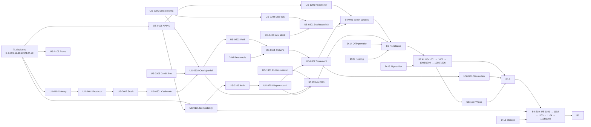

# 07 — Milestones and Sprints

> **Status: PROPOSED — AWAITING TEAM LEADER APPROVAL**
> Scenario A (staged releases R1 → R1.1 → R2), per D-01 and CR-01. Effort is in developer-days (dd) for **one developer working sequentially**. Nothing is assumed to run in parallel except external lead times (provider accounts, hosting, SDK install), which are TL actions.
> Sprint lengths vary (4–6.5 dd) to fit coherent, demoable goals rather than an arbitrary calendar.

## 1. Overview

| Sprint | Milestone | Goal | dd | Cum. dd | Release |
|---|---|---|---|---|---|
| S1 | M1 Financial Integrity Foundation | *Trustworthy core + mobile foundation* (v0.4, [14](14-sprint-1-execution-plan.md)): safe, exact, audited, authorized financial API on `/api/v1`; Flutter app signing in on real phones; mobile design foundation (DR-1, DR-2); barcode spike; gate G-FL | **12.75** | 12.75 | R1 |
| S2 | M2 Catalog & Sales Core | Products, stock, product-linked cash/credit/partial sales, immutable invoices; barcode → lookup integration | 5.25 | 18.0 | R1 |
| S3 | M3 Debts, Returns & Insights + Web Foundation | Returns, due/overdue, statements, payments v1, dashboard; React shell, auth, dashboard | 6.5 | 24.5 | R1 |
| S4 | M4 Web Admin (R1) | All R1 back-office screens on the web; mobile hi-fi designs (US-1508) | 6.0 | 30.5 | R1 |
| S5 | M5 Mobile POS (R1) | Barcode POS, checkout, customers, payments, dashboard on Android | 6.0 | 36.5 | R1 |
| S6 | M6 R1 Release | OTP activation, deployment, backups, performance checks, UAT, release | 4.0 | **40.5** | **R1** |
| S7 | M7 Controlled AI Assistant | AI read tools and payment/invoice drafts with confirmation, on web and mobile | 4.75 | 45.25 | R1.1 |
| S8 | M8 Secure Sharing & Mobile Completion | Secure debt link, public statement, WhatsApp, mobile voice, mobile returns | 3.5 | **48.75** | **R1.1** |
| S9 | M9 Offline Foundations | Sync API, local cache, offline sale/payment capture | 5.5 | 54.25 | R2 |
| S10 | M10 Sync, Conflicts & R2 Release | FIFO sync engine, indicator, queue limit, conflict review, performance, release | 5.5 | **59.75** | **R2** |

> **v0.4 (2026-10-13):** figures follow the approved Sprint 1 plan ([14 §10.5](14-sprint-1-execution-plan.md)). R1 = 35.75 → **40.5 dd** base (≈ 48.1 with contingency). Gate G-FL moved from the end of S2 to the end of S1.

**Contingency (v0.2, differentiated):**

| Scope | Rate | Running total with contingency |
|---|---|---|
| Flutter work in R1 (8.5 dd) | 30% until gate G-FL calibrates it | — |
| Rest of R1 | 15% | R1 ≈ **48.1 dd** (v0.4; was ≈ 42.4) |
| R1.1 | 15% | ≈ 51.9 dd |
| R2 | 25% | ≈ 65.6 dd |

The derivation is in [11 §5](11-risk-register-and-feasibility.md) and [13 §1](13-final-review-and-decision-pack.md).

**Day-20 line:**

- **At base pace (v0.4):** it falls in early S3 (S1 + S2 = 18.0 dd).
- **With 15% slippage:** about 17.4 dd of planned work is done, which is late S2.

What is demoable at that point is listed in [02 §5](02-mvp-scope-and-release-strategy.md#5-what-is-demoable-at-day-20-scenario-a). **It is not a launchable release.**

---

## 2. Milestones

### M1 — Financial Integrity Foundation (S1)

- **Business outcome:** The existing debt, payment and invoice core cannot double-charge, drift by fractions, or be altered without a trace. The current tests stay green.
- **Requirements:** FR-06, FR-07, FR-09, FR-45, FR-47, FR-66 (server), FR-70, NFR-08, NFR-10, NFR-11, BR-03.
- **Deliverables:**
  - Idempotency middleware and table.
  - `Money` helper and `decimal:0,2` validation.
  - `audit_logs`.
  - Login throttling and token expiry.
  - Policies for the role matrix; user deactivation.
  - `/api/v1` with the error envelope.
  - Store timezone.
  - MySQL-parity test job.
  - Design tokens.
- **Dependencies:** Decisions D-04, D-09, D-12/CR-10, D-13, D-22, D-23 (value), D-24, CR-14 approved; D-28 done (SRS v1.1 committed). *(v0.2: D-01 and D-02 no longer block S1, because S1 content is identical in every scenario.)*
- **Acceptance conditions:** DEF-02, 03, 04, 07, 08, 09, 14 closed by tests; probe scenarios converted into regression tests.
- **Risks:** R-04 (regressions in existing behaviour); R-12 (MySQL setup).
- **Exit criteria:** Full suite green on sqlite **and** MySQL; the authorization matrix test passes; Definition of Done (DoD, [09 §8](09-testing-and-definition-of-done.md)) is met for every story.
- **Duration:** 6.5 dd.
- **Decision points:** confirm the timezone value (D-23); confirm the CI host (GitHub Actions).

### M2 — Catalog & Sales Core (S2)

- **Business outcome:** A product-based sale (cash, credit or partial) updates stock, debt and money atomically through the API. Invoices are immutable and corrected by void. The Flutter toolchain is proven on a device.
- **Requirements:** FR-15, FR-16, FR-17 (lookup + spike), FR-19–28, FR-30, FR-31, FR-34–36, BR-01, BR-04, BR-07, BR-11, NFR-10, NFR-13, UC-07, UC-09, UC-10, UC-11.
- **Deliverables:**
  - APIs: products, stock movements and adjustments, low stock, barcode lookup.
  - Debt schema extension.
  - `POST /sales`, `POST /sales/{id}/void`; credit limit.
  - POS and checkout wireframes.
  - Flutter skeleton: login, API call, barcode scan.
- **Dependencies:** M1; D-06, D-07, D-08, D-10, D-20, D-26, D-27; Flutter SDK and an Android device available (A-05).
- **Acceptance conditions:**
  - AC-03 passes at API level.
  - DEF-01, DEF-05, DEF-06, DEF-11 are closed.
  - The stock invariant test passes.
- **Risks:** R-02 (Flutter learning curve), R-05 (schema backfill).
- **Exit criteria:** All S2 stories meet the DoD. The skeleton app scans a real barcode and shows the product returned by the API.
- **Duration:** 7.0 dd.
- **Decision points:** pin the Flutter packages (US-1301); **gate G-FL**: re-estimate S5 if k > 1.3 or a spike fails.

### M3 — Debts, Returns & Insights + Web Foundation (S3)

- **Business outcome:** Returns, overdue tracking, statements and the dashboard are correct at the API level. The owner can register, log in and see the dashboard on the web.
- **Requirements:** FR-01, FR-03–05 (web), FR-12–14, FR-32, FR-33, FR-37–42, FR-46–48, NFR-14, UC-01, UC-03, UC-12, UC-13, UC-14, UC-15, UC-17, AC-04, AC-10.
- **Deliverables:**
  - APIs: returns; debt lists; payments v1 (filters, group reversal rule, `reversed_by`); customer summary and statement; dashboard v2.
  - React: API client, shell, auth (login fix, register), dashboard.
  - Web admin wireframes.
- **Dependencies:** M2; D-05, D-11, D-21.
- **Acceptance conditions:** AC-04 and AC-10 pass at API level; DEF-10, DEF-12, DEF-13 closed.
- **Risks:** R-06 (return-rule disputes).
- **Exit criteria:** DoD met; React build and lint (`no-undef`) are green in CI.
- **Duration:** 6.5 dd.
- **Decision points:** confirm D-30 (no web sale creation).

### M4 — Web Admin (R1) (S4)

- **Business outcome:** An owner or manager can run the whole back office from the browser.
- **Requirements:** FR-08–16, FR-20–22, FR-29–32, FR-34–42 (web parts), UC-04–07, UC-09, UC-12–15.
- **Deliverables:** Screens SCR-W-06 to SCR-W-15.
- **Dependencies:** M3.
- **Acceptance conditions:** UI-AC-04 to UI-AC-08, UI-AC-11 and UI-AC-12 (web parts) pass; manual web flows run against staging-like data.
- **Risks:** R-10 (UI scope creep).
- **Exit criteria:** DoD met; the web regression checklist passes.
- **Duration:** 5.25 dd.
- **Decision points:** hosting target selected (D-25) by the end of S4.

### M5 — Mobile POS (R1) (S5)

- **Business outcome:** Staff sell, collect payments and look up customers on Android, online.
- **Requirements:** FR-03, FR-04, FR-10, FR-14, FR-17, FR-18, FR-19, FR-22–27, FR-38, FR-46, FR-47, NFR-02, NFR-12, UC-03, UC-05, UC-08, UC-10, UC-11, UC-13, UC-17, AC-01, AC-02.
- **Deliverables:** Screens SCR-M-01 to SCR-M-11.
- **Dependencies:** M2 (API), M3 (payments v1, dashboard v2).
- **Acceptance conditions:** AC-01, AC-02 and AC-03 work end to end on the reference device; a network-retry test shows no duplicate.
- **Risks:** R-02, R-03 (barcode performance on low-end devices).
- **Exit criteria:** DoD met; `flutter analyze` is clean; the release APK installs and runs the sale flow.
- **Duration:** 6.5 dd.
- **Decision points:** confirm the reference device model.

### M6 — R1 Release (S6)

- **Business outcome:** R1 "Core Shop" is deployed, recoverable, and accepted.
- **Requirements:** FR-02, BR-09, UC-01, UC-02, NFR-01, NFR-02, NFR-08, NFR-16; regression of all R1 requirements.
- **Deliverables:**
  - OTP flow.
  - Staging and production environments.
  - Backup and restore drill.
  - Performance report.
  - UAT report.
  - Release notes and known limitations.
- **Dependencies:** M4, M5; D-14 (provider), D-25 (hosting).
- **Acceptance conditions:** Release gate G-R1 ([09 §9](09-testing-and-definition-of-done.md)) is passed.
- **Risks:** R-09 (OTP provider onboarding), R-11 (hosting).
- **Exit criteria:** TL sign-off on G-R1.
- **Duration:** 4.0 dd.
- **Decision points:** go/no-go for R1; decide whether to start R1.1 or address pilot feedback first.

### M7 — Controlled AI Assistant (S7)

- **Business outcome:** Users ask business questions and create payments and invoices in natural language, safely.
- **Requirements:** FR-49–59, FR-61–63, BR-02, BR-13, BR-14, UC-18–20, AC-08, AC-09.
- **Deliverables:**
  - AI adapter and evaluation report.
  - Tools, drafts, confirmation.
  - Chat on web and mobile.
- **Dependencies:** R1 services; D-15, D-29.
- **Acceptance conditions:** AC-08 and AC-09 pass; the evaluation set meets the agreed accuracy threshold (proposal: ≥ 85% correct intent and entities, and 100% no-write-without-confirm).
- **Risks:** R-07, R-08.
- **Exit criteria:** DoD met; the AI safety test suite is green.
- **Duration:** 4.75 dd.
- **Decision points:** provider selection after the spike.

### M8 — Secure Sharing & Mobile Completion (S8)

- **Business outcome:** Owners share expiring debt statements via WhatsApp; staff use voice and process returns on mobile.
- **Requirements:** FR-43, FR-44, FR-60 (mobile), FR-32 (mobile), BR-06, NFR-07, NFR-09, UC-16, UC-21, UC-12, AC-05.
- **Deliverables:** Debt-link API, public page, share actions, voice input, mobile return.
- **Dependencies:** M7 (voice → AI), US-0302 (statement).
- **Acceptance conditions:** AC-05 passes; statement page loads in ≤ 3 s at 4G (NFR-07).
- **Risks:** R-13 (privacy leak through the link).
- **Exit criteria:** Release gate G-R1.1 is passed.
- **Duration:** 3.5 dd.

### M9 — Offline Foundations (S9)

- **Business outcome:** Sales and payments can be captured with no internet and are held safely on the device.
- **Requirements:** FR-64, FR-65, FR-66 (sync), NFR-03, NFR-04, NFR-05, BR-08, BR-10, UC-22.
- **Deliverables:**
  - `/sync/batch` and `/sync/bootstrap`; `sync_conflicts`.
  - Local store (per D-19).
  - Offline capture for sales and payments.
- **Dependencies:** R1.1 complete; D-03, D-18, D-19, CR-02.
- **Acceptance conditions:** An airplane-mode sale and payment persist across app restart.
- **Risks:** R-01 (sync correctness), R-14 (local storage choice).
- **Exit criteria:** DoD met; the sync contract tests pass.
- **Duration:** 5.5 dd.

### M10 — Sync, Conflicts & R2 Release (S10)

- **Business outcome:** Offline work synchronizes exactly once and in order; conflicts are reviewable; R2 ships.
- **Requirements:** FR-20 (mobile), FR-65, FR-67, FR-68, FR-69, NFR-03, NFR-05, NFR-06, BR-05, BR-10, BR-12, UC-22, AC-06, AC-07.
- **Deliverables:**
  - Sync engine, indicator and queue limit.
  - Conflict review screen.
  - Mobile stock adjustment.
  - Optional location capture.
  - Performance report.
- **Dependencies:** M9.
- **Acceptance conditions:** AC-06 and AC-07 pass; NFR-06 holds with 100 and 1000 items.
- **Risks:** R-01, R-15 (device fragmentation).
- **Exit criteria:** Release gate G-R2 is passed.
- **Duration:** 5.5 dd.

---

## 3. Sprint Details

> Story details, acceptance criteria and estimates are in [08](08-user-stories-and-technical-tasks.md). The task groups below summarise each sprint by layer.

### S1 — Financial Integrity Foundation (12.75 dd — approved v0.4)

> **v0.4 (2026-10-13):** the TL approved the Sprint 1 execution plan in [14](14-sprint-1-execution-plan.md): 12.75 dd base, ≈ 15.25 with contingency. It adds the Flutter foundation (US-1302 0.75, US-1303, US-1304, US-0205 from S5, US-1305, US-1306), mobile UX (US-1505, US-1501 0.75, US-1506, US-1507, US-1502 from S2) and T-0106-5 (React on `/api/v1`, DEF-12). Full scope, sequence and DoD: [14 §2 – §8](14-sprint-1-execution-plan.md). The table below lists the original backend stories only.

- **Goal:** Close the P0/P1 integrity gaps in existing code before anything is built on top of it.
- **IDs covered:** FR-06, 07, 09, 45, 47, 66 (server), 70; NFR-08, 10, 11, 14 (tokens); BR-03.

| Story | Title | dd |
|---|---|---|
| US-0101 | Duplicate-safe financial writes (+ replay test on every financial endpoint) | 1.5 |
| US-0102 | Exact money handling | 0.75 |
| US-0103 | Critical audit log | 0.75 |
| US-0104 | Auth hardening | 0.25 |
| US-0105 | Role matrix and deactivation | 0.75 |
| US-0106 | API v1 conventions | 0.5 |
| US-0107 | Store timezone | 0.25 |
| US-0108 | MySQL parity and test baseline | 0.5 |
| US-1501 | Design tokens and components | 0.5 |
| US-0109 | SRS baseline verification (v0.2) | 0.25 |
| US-1302 | Flutter environment and device readiness, SP-01 (v0.2; downloads run in the background) | 0.5 |

**Tasks by layer:**

- **Laravel:**
  - `idempotency_keys` migration and middleware.
  - `Money` helper; `decimal:0,2` in all money FormRequests.
  - `audit_logs` migration, model and `AuditService`.
  - Throttle and expiry configuration.
  - Policies; `users.status`.
  - `/api/v1` route group; exception handler for the error envelope.
  - `stores.timezone`.
- **React:** none (deliberate).
- **Flutter:** none.
- **AI:** none.
- **UI/UX:** design tokens; component spec.
- **QA:**
  - Convert the probes into regression tests.
  - MySQL test database plus a CI workflow.
  - Authorization matrix tests.
  - Update the existing tests that assert old behaviour.

**Dependencies / blockers:** D-04, D-09, D-12/CR-10, D-13, D-22, D-23, D-24, CR-14 approved; **D-28: SRS v1.1 committed by the TL** (needed by US-0109); MySQL test database available; two Android phones available (US-1302).

**Demo:**

- Sending the same payment twice gives one payment and a replayed response.
- A 59.999 payment is rejected (422).
- Owner promotion is rejected.
- A reversal appears in the audit log.
- The suite is green on sqlite and MySQL.

**Excluded:** new features, UI work and Flutter *app code*. Only the Flutter toolchain is proven (US-1302).

**Risk:** Medium. It touches proven code; mitigated by the existing tests plus the new ones.

### S2 — Catalog & Sales Core (5.25 dd — v0.4)

> **v0.4:** US-1301's S1 parts (now US-1303 – US-1306) and US-1502 moved to S1; only the US-1301 remainder (T-1301-7, scan → `/products/lookup`, 0.25) stays here. Gate G-FL is decided at the end of S1.

- **Goal:** One atomic, product-based sale path with an immutable history; retire the Flutter toolchain risk early.
- **IDs covered:** FR-15–17, 19–28, 30, 31, 34–36; BR-01, 04, 07, 11; NFR-10, 12, 13; UC-07, 09, 10, 11.

| Story | Title | dd |
|---|---|---|
| US-0401 | Product catalog API (+ barcode lookup) | 0.75 |
| US-0402 | Stock movements and adjustments | 0.75 |
| US-0403 | Low-stock detection | 0.25 |
| US-0305 | Customer credit limit | 0.25 |
| US-0701 | Debt schema extension and due dates | 0.5 |
| US-0501 | Product-linked cash sale with stock deduction | 1.0 |
| US-0502 | Credit and partial sale | 0.75 |
| US-0503 | Invoice immutability and void | 0.75 |
| US-1502 | POS and checkout wireframes | 0.5 |
| US-1301 | Flutter walking skeleton + spikes SP-02 – SP-04 → **gate G-FL** | 1.5 |

**Tasks by layer:**

- **Laravel:**
  - Migrations: `products`, `stock_movements`, `customers.credit_limit`, debts (`customer_id`, `due_date`, `return_credit`) with backfill, invoices (`paid_amount`, `status`, void columns, `created_by`, `client_transaction_id`, nullable `customer_id`), `invoice_items.product_id` and `returned_quantity`.
  - `StockService`, `SaleService`.
  - Remove the `PATCH` (financial fields) and `DELETE` invoice behaviour.
- **Flutter:** project creation; folder template; packages pinned; login; `GET /products/lookup` after a camera scan.
- **UI/UX:** wireframes for SCR-M-02 to SCR-M-06.
- **QA:**
  - Atomicity (fault-injection) tests.
  - Stock invariant test.
  - Backfill migration test.
  - AC-03 API test.
  - Rewrite the existing invoice tests to match D-06.

**Blockers:** D-06, D-07, D-08, D-10, D-20, D-26, D-27; Flutter SDK and an Android device.

**Demo:** Postman/HTTP-file walkthrough: create product → sell 3 (partial) → stock −3, debt = remainder → void → stock restored, debt cancelled, audit entry. Then a phone scans a barcode and shows the product.

**Gate G-FL (end of S2):**

- If spike SP-02 or SP-03 fails, or the pace factor k > 1.3, then S5 is re-estimated as 6.5 × k.
- The TL then decides: re-plan, add a Flutter contributor, or reduce the mobile scope.
- The decision is recorded in the S2 status note.

**Excluded:** returns, web screens, mobile POS screens.

**Risk:** **High** (schema changes plus a new toolchain).

### S3 — Debts, Returns & Insights + Web Foundation (6.5 dd)

- **Goal:** Complete the R1 API and establish the React foundation.
- **IDs covered:** FR-01, 03–05, 12–14, 32, 33, 37–42, 46–48; NFR-14; UC-01, 03, 12–15, 17; AC-04, AC-10.

| Story | Title | dd |
|---|---|---|
| US-0601 | Sale return API | 1.25 |
| US-0702 | Due / overdue / highest-balance lists | 0.5 |
| US-0703 | Payments v1 (+ financial invariant test TC-0703-06) | 1.0 |
| US-0302 | Customer summary and statement API | 0.75 |
| US-0801 | Dashboard metrics v2 | 0.75 |
| US-1503 | Web admin wireframes | 0.5 |
| US-1201 | React app shell and API client | 0.75 |
| US-0202 | Web login, logout, session | 0.25 |
| US-0201 | Web owner registration | 0.25 |
| US-0802 | Web dashboard | 0.5 |

**Tasks by layer:**

- **Laravel:** `sale_returns` and `sale_return_items`; `ReturnService`; `DebtService` lists; payments `store_id`/`customer_id`/`reversed_by` backfill; group-only reversal; `StatementService`; dashboard collections and insights.
- **React:** `apiClient`; TanStack Query; layout with RTL navigation; role-aware routes; fix the login defect; wire registration; dashboard page.
- **QA:** AC-04 and AC-10 API tests; statement reconciliation test; overdue boundary tests in the store timezone; React lint + build in CI.

**Blockers:** D-05, D-11, D-21.

**Demo:** Process a return on a partially paid sale and show the debt reduction and refund. The web dashboard shows the period KPIs and insight cards after a real login.

**Excluded:** web CRUD screens (S4), mobile.

**Risk:** Medium.

### S4 — Web Admin (R1) (6.0 dd — v0.4)

> **v0.4:** adds US-1508, mobile hi-fi designs for the R1 screens (0.75 dd), before S5.

- **Goal:** The back office on the web.

| Story | Title | dd |
|---|---|---|
| US-0204 | Staff management UI | 0.5 |
| US-0301 | Customer management UI (+ deactivation, FR-11) | 1.0 |
| US-0303 | Customer detail and statement UI | 0.5 |
| US-0405 | Products and stock UI | 0.75 |
| US-0504 | Sales list and detail (+ void) | 0.5 |
| US-0602 | Return UI | 0.5 |
| US-0704 | Debts and payments UI | 1.0 |
| — | Sprint integration and regression | 0.5 |

**Tasks by layer:**

- **React:** screens SCR-W-06 to SCR-W-15; shared components (`MoneyText`, `StatusBadge`, `ConfirmSummary`, `DataTable`, `ReasonDialog`).
- **Laravel:** fixes found during integration only.
- **QA:** web regression checklist; keyboard-only checks (UI-AC-11); role checks (UI-AC-07).

**Blockers:** none beyond M3. **D-25 (hosting) should be decided during S4.**

**Demo:** Walk through a full day in the back office (create product, adjust stock, view a sale, process a return, record and reverse a payment, invite an employee).

**Excluded:** AI, secure link, web POS.

**Risk:** Low–Medium.

### S5 — Mobile POS (R1) (6.0 dd — v0.4)

> **v0.4:** US-0205 (mobile session) moved to S1.

- **Goal:** The daily till on Android.

| Story | Title | dd |
|---|---|---|
| US-0205 | Mobile session handling | 0.5 |
| US-0505 | POS cart with barcode and repeat-scan increment | 1.5 |
| US-0506 | Mobile checkout | 1.25 |
| US-0304 | Customer lookup and quick-create | 0.5 |
| US-0705 | Mobile debts and payment recording | 1.0 |
| US-0406 | Mobile product search and low stock | 0.5 |
| US-0803 | Mobile dashboard summary | 0.5 |
| — | Mobile states hardening and regression | 0.75 |

**Tasks by layer:**

- **Flutter:** screens SCR-M-01 to SCR-M-11; `ApiClient` idempotency persistence; error, empty and loading states; RTL.
- **Laravel:** fixes only.
- **QA:** widget tests for the cart (repeat scan) and checkout validation; device test for AC-01, AC-02 and AC-03; network-retry no-duplicate test; NFR-02 timing.

**Blockers:** reference device available.

**Demo:** A real phone runs barcode sale → partial payment → customer balance → collect payment → dashboard. The web shows the same numbers.

**Excluded:** offline mode, AI, returns on mobile.

**Risk:** **High** (developer's Flutter experience).

### S6 — R1 Release (4.0 dd)

- **Goal:** Ship R1 safely.

| Story | Title | dd |
|---|---|---|
| US-0203 | Phone OTP at registration | 1.0 |
| US-1401 | Environments and deployment | 0.75 |
| US-1402 | Backup and restore drill | 0.25 |
| US-1404 | Performance checks | 0.5 |
| US-1403 | UAT and release | 1.0 |
| — | Stabilization buffer | 0.5 |

**Tasks by layer:**

- **Laravel:** OTP service and driver; store status gate; production configuration.
- **React:** OTP screen.
- **Ops:** staging and production setup, HTTPS, backups.
- **QA:** acceptance run of AC-01–04 and AC-10; G-R1 checklist.

**Blockers:** D-14, D-25; provider and hosting accounts (TL lead time — **start in S1**).

**Demo:** Production smoke test; restore drill evidence.

**Excluded:** AI, link, offline.

**Risk:** Medium (external services).

### S7 — Controlled AI Assistant (4.75 dd)

| Story | Title | dd |
|---|---|---|
| US-1504 | AI chat and preview wireframes | 0.25 |
| US-1001 | AI adapter and evaluation spike | 0.75 |
| US-1002 | AI read tools and daily summary | 1.0 |
| US-1003 | AI payment draft with confirmation | 0.75 |
| US-1004 | AI invoice draft with confirmation | 1.0 |
| US-1005 | Web AI chat | 0.5 |
| US-1006 | Mobile AI chat | 0.5 |

- **Blockers:** D-15 (provider account and key), D-29.
- **Demo:** Arabic questions answered from real data; "أبو محمد دفع 50" → preview → confirm → payment; cancel → nothing written; a cross-store probe is denied.
- **Excluded:** voice (S8).
- **Risk:** Medium–High.

### S8 — Secure Sharing & Mobile Completion (3.5 dd)

| Story | Title | dd |
|---|---|---|
| US-0901 | Secure link API | 0.75 |
| US-0902 | Public statement page | 0.5 |
| US-0903 | WhatsApp share | 0.25 |
| US-1007 | Mobile voice input | 0.75 |
| US-0603 | Mobile return | 0.75 |
| — | R1.1 regression and release | 0.5 |

- **Demo:** Generate a link → open it on another phone → revoke → the link is dead. Voice payment request → preview.
- **Risk:** Low–Medium.

### S9 — Offline Foundations (5.5 dd)

| Story | Title | dd |
|---|---|---|
| US-1101 | Batch sync API with conflict state | 1.5 |
| US-1102 | Local cache (includes the D-19 benchmark) | 1.5 |
| US-1103 | Offline sale and payment capture | 2.0 |
| — | Regression | 0.5 |

- **Blockers:** D-03, D-18, D-19, CR-02.
- **Demo:** Airplane mode → sell and record a payment → kill and reopen the app → the items are still queued.
- **Risk:** **High**.

### S10 — Sync, Conflicts & R2 Release (5.5 dd)

| Story | Title | dd |
|---|---|---|
| US-1104 | FIFO sync engine and indicator | 1.5 |
| US-1105 | Queue limit | 0.5 |
| US-1106 | Conflict review (web) | 1.0 |
| US-0407 | Mobile stock adjustment | 0.5 |
| US-1405 | Offline performance tests | 1.0 |
| US-1107 | Optional location capture (Could) | 0.5 |
| — | R2 release | 0.5 |

- **Optional, not in the baseline:** US-1008 (web voice, +0.5 dd).
- **Demo:** 10 offline items sync FIFO exactly once (AC-07); a conflict is resolved on the web.
- **Risk:** **High**.

---

## 4. Dependency Graph and Critical Path



**Critical path for R1 (single developer, so effectively sequential):**

```
TL decisions → US-0106 → US-0101 → US-0102 → US-0401 → US-0402 → US-0701 → US-0501 → US-0502 → US-0503
→ US-0601 → US-0703 → US-0302 → US-0801 → US-1201 → S4 web → (US-1301 done in S2) → S5 mobile → US-1401 → US-1403 → R1
```

**Mandatory ordering rules:**

| Must come first | Before | Reason |
|---|---|---|
| Idempotency (US-0101) | Any client financial integration and all sync work | Retries and offline are unsafe without it |
| Product model (US-0401/0402) | Barcode, POS, inventory, returns, AI invoice drafts | They all reference products |
| Return rule decision (D-05) | US-0601 | Business rule must be explicit |
| API contracts ([05](05-data-model-and-api-contracts.md)) + `/api/v1` (US-0106) | React (S3) and Flutter (S5) integration | Avoids client rework |
| AI tool contracts + role matrix (US-0105) | AI drafts (US-1003/1004) | BR-13 |
| Design tokens + POS wireframes (US-1501/1502) | Broad UI production (S3–S5) | Consistency |
| CI with MySQL (US-0108) | Every release gate | DEF-16 |

**External lead times:** the TL should start these in S1, in parallel with development:

| Item | Lead time | Needed by |
|---|---|---|
| Flutter SDK + Android devices | Downloads (hours on slow links); 0.5 dd of developer time is planned as US-1302 | S1 |
| Hosting account | 1–3 days | S6 |
| OTP provider account and sender approval | Days to weeks (unverified) | S6 |
| AI provider account and billing | 1 day | S7 |

---

## 5. Progress Tracking Format

A weekly status note (`docs/sdlc/status/YYYY-MM-DD.md`, created during implementation, not now):

```
Sprint: S2 (day 3 of 6.5)          Overall: 9.0 / 35.75 dd to R1 (25%)
Done (DoD met):   US-0401, US-0402
In progress:      US-0501 (tests failing: TC-0501-03)
Blocked:          US-1301 — waiting Android device (A-05)
Decisions needed: D-27 confirm no negative stock
Defects opened/closed: DEF-19 opened (P2), DEF-05 closed
Risks changed:    R-02 ↑ (Flutter setup took 0.5 dd longer)
Burn-down: planned 9.5 dd / actual 9.0 dd · forecast R1 = 34.5 dd
```

Each story is tracked as a GitHub Issue named `US-xxxx`, with a checklist copied from its DoD. The board columns are: Backlog → Ready (decisions approved) → In progress → In review (tests green) → Done (DoD verified).
